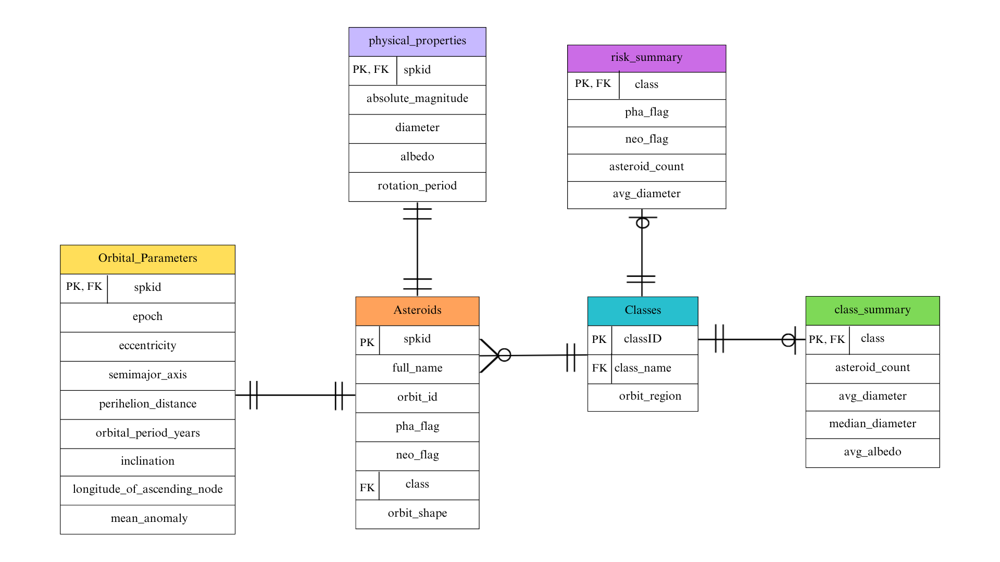

# Asteroid ETL Pipeline

An end-to-end ETL workflow that fetches asteroid data from NASA JPL's Small-Body Database API, cleans and engineers orbital features with Pandas, and loads the normalized dataset into a PostgreSQL database running on Docker.

---

## Architecture & Data Model

The raw API dataset is transformed and normalized into 5 relational tables to remove redundancy and enforce referential integrity.



### Tables

* **`orbit_classes`**: Reference dimension containing unique orbital class codes (`MBA`, `AMO`, `TJN`, etc.).
* **`asteroids`**: Core table holding unique asteroid IDs (`spkid`), designations, classifications, hazard flags, and orbit shapes.
* **`orbital_parameters`**: Keplerian orbital elements (semi-major axis, eccentricity, inclination, orbital period in years, Earth MOID).
* **`physical_properties`**: Physical metrics including diameter, absolute magnitude, albedo, and rotation period.
* **`class_summary`**: Aggregated roll-up table with counts, mean/median diameters, and albedos per asteroid class.

---

## Pipeline Overview

1. **Extract**: Pulled 1,500 small-body records from NASA's JPL SSD API (`sbdb_query.api`).
2. **Transform** ([cleaning.ipynb](cleaning.ipynb)):
   * Cast object columns to appropriate numeric types.
   * Imputed missing diameters and albedos using astrophysics formulas ($D = 1329 \times 10^{-H/5} / \sqrt{p_V}$), falling back to medians for remaining nulls.
   * Engineered features: orbital period in years ($T = a^{1.5}$) via Kepler's third law, aphelion distance, and discrete eccentricity bins (`orbit_shape`).
   * Cleaned redundant features and exported to [dataset/cleaned_asteroids.csv](dataset/cleaned_asteroids.csv).
3. **Load** ([src/load.py](src/load.py)):
   * Connects to PostgreSQL using SQLAlchemy and Psycopg2.
   * Splits the cleaned dataset into 5 relational DataFrames.
   * Drops previous tables with `CASCADE` to avoid stale foreign key locks, populates tables, and applies `PRIMARY KEY` and `FOREIGN KEY` constraints.

---

## How to Run

### 1. Start the Database

Start the PostgreSQL 16 container via Docker Compose:

```bash
docker compose up -d
```

### 2. Configure Environment

Ensure your `.env` contains:

```env
DB_HOST= *specify_your_host*
DB_PORT= *specify_your_port*
DB_NAME= *specify_your_db_name*
DB_USER= *specify_your_db_user*
DB_PASSWORD= *specify_your_db_password*
```

### 3. Run the Loader

```bash
python3 src/load.py
```

---

## Database Queries & Verification

Access the PostgreSQL CLI inside the running container:

```bash
docker exec -it asteroids-postgres psql -U postgres -d asteroids_db
```


### Sample Queries

#### 1. Top 5 Largest Asteroids with Orbital & Physical Properties

```sql
SELECT 
    a.spkid,
    a.full_name,
    a.class,
    p.diameter,
    p.albedo,
    ROUND(o.orbital_period_years::numeric, 2) AS period_yr,
    a.orbit_shape
FROM asteroids a
JOIN physical_properties p ON a.spkid = p.spkid
JOIN orbital_parameters o ON a.spkid = o.spkid
ORDER BY p.diameter DESC
LIMIT 5;
```

```text
  spkid   |        full_name         | class | diameter | albedo | period_yr |      orbit_shape      
----------+--------------------------+-------+----------+--------+-----------+-----------------------
 20000001 | 1 Ceres (A801 AA)        | MBA   |    939.4 |   0.09 |      4.60 | circular
 20000004 | 4 Vesta (A807 FA)        | MBA   |   522.77 | 0.4228 |      3.63 | circular
 20000002 | 2 Pallas (A802 FA)       | MBA   |      513 |  0.155 |      4.61 | moderate_eccentricity
 20000010 | 10 Hygiea (A849 GA)      | MBA   |   407.12 | 0.0717 |      5.59 | moderate_eccentricity
 20000704 | 704 Interamnia (A910 TC) | MBA   |  306.313 |  0.078 |      5.34 | moderate_eccentricity
(5 rows)
```

#### 2. Class Summary & Averages

```sql
SELECT 
    class,
    asteroid_count,
    ROUND(average_diameter::numeric, 2) AS avg_diameter_km,
    ROUND(median_diameter::numeric, 2) AS median_diameter_km,
    ROUND(average_albedo::numeric, 3) AS avg_albedo
FROM class_summary
ORDER BY asteroid_count DESC;
```

```text
 class | asteroid_count | avg_diameter_km | median_diameter_km | avg_albedo 
-------+----------------+-----------------+--------------------+------------
 MBA   |           1344 |           54.53 |              38.45 |      0.148
 OMB   |            110 |           81.86 |              72.95 |      0.072
 MCA   |             22 |           34.93 |              40.68 |      0.135
 TJN   |             12 |          122.86 |             116.21 |      0.048
 IMB   |              6 |            6.37 |               6.63 |      0.568
 AMO   |              5 |           20.08 |              16.84 |      0.220
 CEN   |              1 |           38.00 |              38.00 |      0.060
(7 rows)
```

#### 3. Near-Earth Objects (NEO) Ranked by Earth Collision Proximity (MOID)

```sql
SELECT 
    a.spkid,
    a.full_name,
    a.class,
    ROUND(o.minimum_orbit_intersection_distance::numeric, 4) AS earth_moid_au,
    ROUND(o.perihelion_distance::numeric, 3) AS perihelion_au,
    p.diameter,
    a.neo_flag
FROM asteroids a
JOIN orbital_parameters o ON a.spkid = o.spkid
JOIN physical_properties p ON a.spkid = p.spkid
WHERE a.neo_flag = 'Y'
ORDER BY o.minimum_orbit_intersection_distance ASC;
```

```text
  spkid   |       full_name        | class | earth_moid_au | perihelion_au | diameter | neo_flag 
----------+------------------------+-------+---------------+---------------+----------+----------
 20000887 | 887 Alinda (A918 AA)   | AMO   |        0.0801 |         1.061 |      4.2 | Y
 20001221 | 1221 Amor (1932 EA1)   | AMO   |        0.1090 |         1.085 |        1 | Y
 20000433 | 433 Eros (A898 PA)     | AMO   |        0.1490 |         1.133 |    16.84 | Y
 20000719 | 719 Albert (A911 TB)   | AMO   |        0.2020 |         1.196 |   40.676 | Y
 20001036 | 1036 Ganymed (A924 UB) | AMO   |        0.3420 |         1.243 |   37.675 | Y
(5 rows)
```
